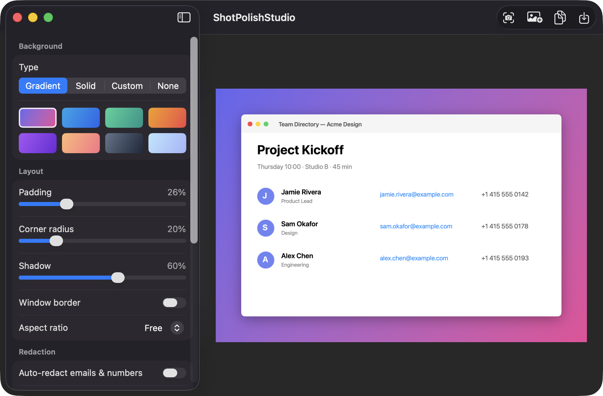
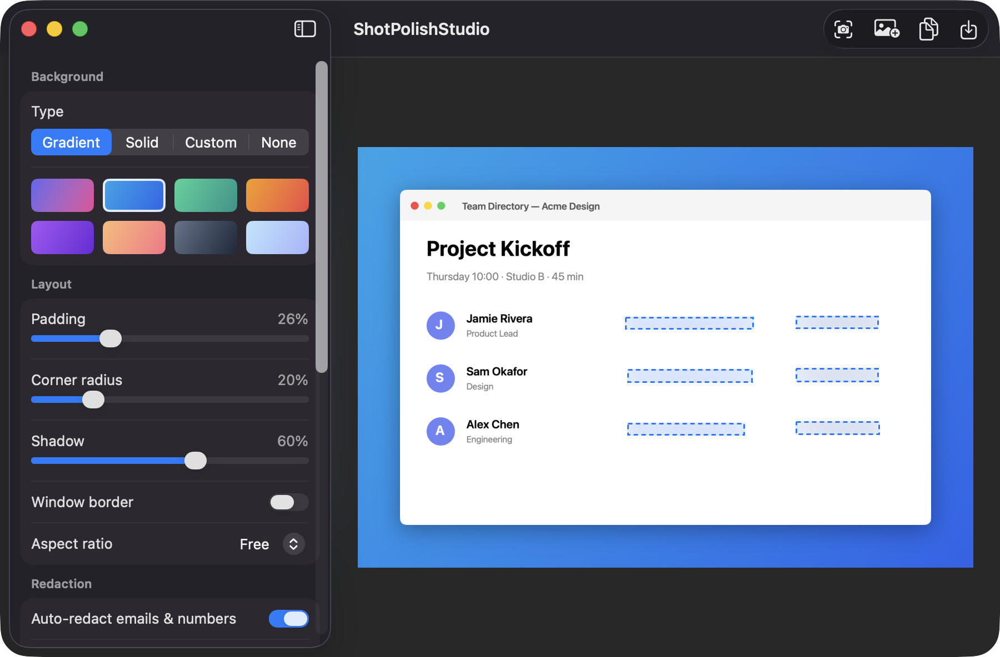
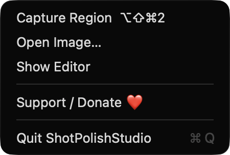

# ShotPolishStudio

**🌐 Website:** [turhe123.github.io/shot-polish-studio](https://turhe123.github.io/shot-polish-studio/)

Turn a raw screenshot into a share-ready image with a gradient backdrop, padding, shadow and rounded corners.

> 🆓 A free, open-source **Xnapper alternative** for macOS 14+. Native Swift, no accounts, no subscriptions, MIT licensed.


## Why

ShotPolishStudio is a free, open-source, 100% native, backend-free alternative to paid utilities in the *Menu Bar Utility* category. It was inspired by Xnapper ($24.99 one-time), and focuses on the beautifying step: capture or drop in a screenshot, tune the look, and export. Everything runs on your Mac. Your images are never uploaded anywhere.

## Features

- **Capture a region** with the global hotkey `⌥⇧⌘2` or from the menu bar item (ScreenCaptureKit, single frame, with a live size readout while selecting).
- **Drop, paste or open** an image: drag-and-drop onto the window, `⌘V` (files or raw clipboard images), or `⌘O`.
- **Backgrounds**: 8 built-in two-color gradients (Dusk, Ocean, Mint, Sunset, Grape, Peach, Slate, Sky), a solid color, a custom top/bottom color pair, or a transparent background.
- **Layout controls**: sliders for padding, corner radius and shadow strength, an optional window-style border, and aspect ratio presets (Free, 1:1, 16:9, 4:3).
- **Auto-redact** (off by default): on-device Vision text recognition finds email addresses, phone numbers and long digit sequences, then covers them with Blur, Pixelate or a Solid Box. Click any box in the preview to remove it, and use *Scan Again* or Undo (`⌘Z`) as needed.
  Auto-redaction is a helper, not a guarantee. Always review the preview before sharing.
- **Export** as PNG or JPEG: Copy to Clipboard (`⌘C`), Save As… (`⌘S`), or Save to Default Folder (`⌥⌘S`). The default folder is your choice and is remembered.
- **Settings are remembered** between launches (background, colors, padding, format, and so on).
- Live preview is downscaled for large images; the export is rendered from the full-resolution original.
- Menu bar item with Capture Region, Open Image…, Show Editor, Support and Quit.

## Screenshots

<p align="center"></p>

<p align="center"><em>The editor puts a pasted screenshot on a Dusk gradient with padding, rounded corners and a soft shadow, with background and layout controls in the sidebar.</em></p>

<p align="center"></p>

<p align="center"><em>Auto-redact finds the email addresses and phone numbers with on-device text recognition and blurs them, shown here on the Ocean gradient.</em></p>

<p align="center"></p>

<p align="center"><em>The menu bar menu has Capture Region (⌥⇧⌘2), Open Image…, Show Editor and Support.</em></p>

## Install

1. Download `ShotPolishStudio-macOS.zip` from the [latest release](https://github.com/turhe123/shot-polish-studio/releases/latest).
2. Unzip it and move `ShotPolishStudio.app` to `/Applications`.
3. The app is open source and not notarized, so clear the quarantine flag:

   ```bash
   xattr -cr /Applications/ShotPolishStudio.app
   ```

4. Right-click the app and choose **Open** the first time you launch it.

Requires macOS 14.0 or later.

## Build from source

You need Xcode and [XcodeGen](https://github.com/yonaskolb/XcodeGen).

```bash
brew install xcodegen
xcodegen generate
xcodebuild -project ShotPolishStudio.xcodeproj -scheme ShotPolishStudio -configuration Release -derivedDataPath ./build build
```

The app is produced at `build/Build/Products/Release/ShotPolishStudio.app`.

## Permissions

- **Screen Recording**: required only for *Capture Region*. The app asks lazily, with a plain explanation, the first time you capture. After granting access in System Settings › Privacy & Security you may need to relaunch the app. Dropping, pasting and opening images works without it.
- **File access**: when you pick a save location or default folder, macOS shows the standard file panels. The chosen folder is remembered as a bookmark.
- **Accessibility**: not requested. The global hotkey is registered through Carbon, which doesn't need it.
- **Microphone, Camera, network**: not used.

## Built with AI

ShotPolishStudio was written by [Claude Code](https://claude.com/claude-code) inside an automated pipeline, from a plain-English spec. No code, binaries or assets from any commercial app were used; it is a clean-room reimplementation of a feature set, not a copy.

What that means in practice:

- The full source is in this repo under the MIT license. Read it before you run it.
- No network calls, no analytics, no third-party dependencies. Only Apple frameworks.
- Ad-hoc signed and not notarized, which is why Gatekeeper warns on first launch.
- It has had less human review than a hand-written app. Bug reports and pull requests are welcome.

## Support ❤️

If ShotPolishStudio saves you time, you can support its development:

[Support Or (Leo) Davidai ❤️](https://ko-fi.com/leodavidai)

The app also has a *Support / Donate ❤️* button in the sidebar, the menu bar menu and the Help menu.

## More free Mac apps

ShotPolishStudio is one of a growing collection of [free, open-source Mac utilities](https://github.com/turhe123/mac-apps) built the same way: native Swift, no accounts, no telemetry. Browse the full gallery at [turhe123.github.io/mac-apps](https://turhe123.github.io/mac-apps/).

Prefer something that runs in the browser? The same pipeline builds [free, private web tools](https://turhe123.github.io/web-tools/): PDF, image, developer, data and audio tools, nothing uploaded.

## License

MIT © Or Davidai Bachar
